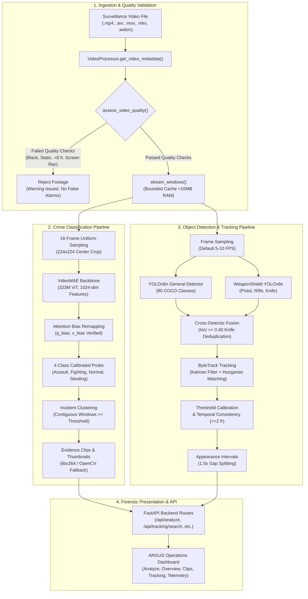

# ARGUS — AI Crime & Surveillance Anomaly Detection Platform

Automated surveillance video intelligence, behavioral anomaly classification, dedicated tactical weapon detection, and multi-object tracking platform for forensic security analysis.

---

## 1. Project Overview

**ARGUS** is an AI-powered surveillance video intelligence and forensic analysis platform. It ingests recorded CCTV footage, analyzes temporal action dynamics using deep video transformers, tracks people and objects across consecutive frames, detects tactical weapons, and provides forensic search tools to rapidly identify security incidents.

Rather than relying on ungrounded heuristic motion alerts or requiring security personnel to review hours of raw video manually, ARGUS processes surveillance footage through a multi-stage computer vision pipeline that isolates anomalous events, provides synchronized forensic timelines, and enables natural language object search.

---

## 2. Problem Statement

Modern security operations and law enforcement agencies face several structural challenges with video surveillance:

- **Massive Video Volume**: Thousands of hours of CCTV footage are recorded daily. Forensic review is labor-intensive, slow, and prone to human fatigue.
- **Unreliable Motion Detection**: Conventional camera-based motion sensors trigger frequent false alarms due to lighting changes, shadows, foliage motion, or weather conditions.
- **Lack of Temporal Behavioral Context**: Standard single-frame object detectors can detect people or cars, but cannot recognize temporal actions such as violent assaults, fighting, or theft.
- **Weapon Misattribution**: Generic object classifiers often fail on small firearms or confuse harmless items (e.g., cell phones, tools, dark umbrellas) with weapons.
- **Fragmented Evidence Triage**: Security personnel need synchronized timestamped evidence clips and searchable object trajectories rather than unindexed video streams.

ARGUS addresses these challenges by combining temporal video action modeling (VideoMAE), general object tracking (YOLOv8 + ByteTrack), dedicated tactical weapon detection (WeaponShield YOLOv8s), and a search-first forensic interface.

---

## 3. Key Features

### 3.1 AI-Based Crime and Anomaly Classification (VideoMAE)
- **Deep Feature Extraction**: Employs a 323-million parameter VideoMAE large transformer backbone (`OPear/videomae-large-finetuned-UCF-Crime`) pretrained on kinetics and fine-tuned on UCF-Crime surveillance video.
- **Calibrated 4-Class Probe**: Classifies temporal windows into four operational classes:
  - `Assault`
  - `Fighting`
  - `Stealing`
  - `Normal` (baseline non-criminal activity)
- **Attention Bias Remapping**: Implements explicit weight remapping for transformer attention bias tensors (`q_bias`, `v_bias` to Hugging Face standard layout), ensuring deterministic feature extraction.
- **Sliding-Window Temporal Sampling**: Analyzes footage in uniform 2.5-second windows with a 1.0-second stride (16 frames per window, resized shortest-edge to 224 and center-cropped to $224 \times 224$).
- **Incident Clustering**: Aggregates contiguous anomalous windows into discrete Security Incidents (`INC-001`, `INC-002`) with assigned severity ratings (`CRITICAL`, `HIGH`, `MEDIUM`, `NONE`).
- **Automated Evidence Extraction**: Automatically generates trimmed MP4 evidence clips with temporal context buffers and captures peak-confidence thumbnail images.
- **Pre-Flight Video Quality Validation**: Rejects unassessable footage (zero-byte files, corrupt video geometry, clips shorter than 0.35s / 8 frames, blank/black frames, frozen static loops, and flat digital screen recordings) before running inference, eliminating false alarms on uninformative data.

### 3.2 General Object Detection (YOLOv8)
- **80 Supported COCO Classes**: Detects persons, vehicles, personal belongings, animals, interior items, and everyday objects using Ultralytics YOLOv8n.
- **Functional Taxonomy**: Groups detected classes into 11 functional categories: *People*, *Weapons*, *Personal Belongings*, *Vehicles*, *Outdoor & Street*, *Animals*, *Sports Equipment*, *Kitchen & Dining*, *Furniture & Interior*, *Electronics & Appliances*, and *Household & Accessories*.
- **Spatial Proximity Analysis**: Computes normalized Euclidean distances between persons and target belongings (`backpack`, `handbag`, `suitcase`, `cell phone`) to detect possession and displacement cues.

### 3.3 Dedicated Tactical Weapon Detection
- **Decoupled Deep Detector**: Employs a dedicated YOLOv8s weapon detection model (`yolov8_weapon.pt`) isolated from general COCO weights to prevent class collision and misattribution.
- **Confirmed Weapon Classes**:
  - `Pistol` (Class 0: Handguns, revolvers, compact firearms)
  - `Rifle` (Class 1: Long guns, shotguns, carbines)
  - `Knife` (Class 2: Edged bladed weapons, daggers, machetes)
- **Cross-Detector IoU Deduplication**: Calculates Intersection-over-Union (IoU $\ge 0.40$) between weapon detections and generic COCO knife detections, suppressing redundant bounding boxes while prioritizing the tactical weapon detector.
- **Person-Weapon Spatial Association**: Evaluates bounding-box Euclidean distance ($\le 0.32$ normalized) to link detected weapons with nearby individuals as proximity cues.

### 3.4 Multi-Object Tracking (ByteTrack)
- **Persistent Trajectories**: Integrates ByteTrack with Kalman filtering to maintain persistent Track IDs (`ID-1`, `WEP-1`, etc.) across frame occlusions and motion.
- **Strict Tracker Lifecycle**: State is scoped strictly to the active video. The tracker cleanly resets between independent video files to prevent ID leakage across sessions.
- **Dual Coordinate Preservation**: Preserves both raw pixel bounding boxes `[x1, y1, x2, y2]` and normalized coordinates `[0.0, 1.0]`, alongside precise source video timestamps.

### 3.5 Universal Custom Object Search & Temporal Exploration
- **Search-First Workspace**: Replaces static inventory cards with a single prominent search bar: *"What object are you looking for?"*.
- **Natural Language Alias Resolution**: Resolves colloquial and domain synonyms to canonical model classes:
  - `handgun`, `glock`, `revolver` $\to$ `Pistol`
  - `gun`, `firearm` $\to$ `Pistol`, `Rifle`
  - `blade`, `dagger`, `machete` $\to$ `Knife`
  - `phone`, `mobile`, `smartphone` $\to$ `cell phone`
  - `bag`, `purse` $\to$ `handbag`, `backpack`, `suitcase`
  - `auto`, `automobile` $\to$ `car`
  - `bike` $\to$ `bicycle`, `motorcycle`
  - `brolly`, `parasol` $\to$ `umbrella`
  - `pup`, `canine` $\to$ `dog`
- **Word-Boundary Matcher**: Token-based matcher prevents false substring collisions (e.g., `alien_raygun` does not match `gun`, while `handgun` resolves to `Pistol`).
- **Two Operational Search Modes**:
  - **Mode A (Fast Query Search)**: In-memory sub-millisecond search across active tracks without additional GPU inference.
  - **Mode B (Targeted Video Scanner)**: Selective interval scan across a specified time range $[t_{\text{start}}, t_{\text{end}}]$ with customizable sampling FPS and target classes, reporting frames examined and coverage percentages.
- **Categorical Feedback**: Clearly reports status as `matches_found`, `no_matches_found`, `supported_not_detected`, or `unsupported_class`.

### 3.6 False-Positive Reduction & Calibrated Confidence Thresholds
- **Calibrated Class Thresholds**: Overrides flat low thresholds to eliminate hallucinated detections on CCTV artifacts:
  - `Pistol`: **0.50** (suppresses specular reflections on car door handles, clothing folds, and hands)
  - `Rifle`: **0.45**
  - `Knife`: **0.40**
  - `clock`: **0.50** (suppresses wheel rims, circular hubcaps, and street signs)
  - `umbrella`: **0.45** (suppresses awnings, bent arms, and jackets)
  - `skateboard`: **0.45** (suppresses ground shadows and curb lines)
  - `person` & `car`: **0.35**
  - `cell phone` & `handbag`: **0.38**
- **Multi-Observation Temporal Consistency**:
  - `confirmed_track`: Requires $\ge 2$ observations across distinct video frames.
  - `uncertain_candidate`: Single-frame observations or sub-threshold scores are flagged for review and barred from triggering high-priority incident alerts.

### 3.7 Timestamp-Based Results & Evidence Navigation
- **Interactive Temporal Heatmap Bar**: Color-coded timeline scrubber synchronized with video playback. Clicking any segment jumps directly to that second.
- **Clickable Appearance Intervals**: Non-continuous observations separated by gaps $> 1.5\text{s}$ are segmented into discrete intervals $[t_{\text{start}}, t_{\text{end}}]$. Clicking an interval pill jumps playback to $t_{\text{start}}$ and renders the trajectory polyline on canvas.
- **Observation Stepper**: Allows frame-by-frame navigation (`Seek First Seen`, `Seek Last Seen`, `◀ Prev Obs`, `Next Obs ▶`) through recorded bounding boxes.
- **Telemetry Modal & Data Export**: Complete inspection modal displaying detector provenance, calibrated threshold, durations, and exportable reports in JSON and CSV formats.

---

## 4. System Architecture



---

## 5. Technologies and Libraries Used

| Component / Layer | Technology / Library | Verified Version | Purpose |
| :--- | :--- | :--- | :--- |
| **Language Runtime** | Python | 3.10 – 3.14 (Tested on 3.14.5) | Primary execution environment |
| **Web Framework** | FastAPI | 0.148.0 | REST API and static file serving |
| **ASGI Server** | Uvicorn | 0.54.0 | High-performance asynchronous server |
| **Deep Learning Framework** | PyTorch | 2.11.0+cu128 | GPU/CPU tensor compute and neural network runtime |
| **Vision Utilities** | Torchvision | 0.26.0+cu128 | Image preprocessing and tensor transformations |
| **Transformer Models** | Hugging Face Transformers | 5.17.0 | VideoMAE backbone loader and feature inference |
| **Object Detection & Tracking** | Ultralytics YOLOv8 | 8.4.187 | YOLOv8n (COCO) and YOLOv8s (WeaponShield) inference |
| **Tracking Assignment** | Lap | 0.5.13 | Linear Assignment Problem solver for ByteTrack |
| **Computer Vision** | OpenCV (`opencv-python`) | 5.0.0.93 | Frame extraction, video decoding/encoding, quality checks |
| **Image Processing** | Pillow (PIL) | 12.3.0 | Image thumbnail generation and format handling |
| **Machine Learning** | Scikit-learn | 1.9.1 | StandardScaler and LogisticRegression classification probe |
| **Model Serialization** | Joblib | 1.6.0 | Serialized 4-class probe persistence |
| **Array Computing** | NumPy | 2.5.2 | Matrix operations, IoU calculations, and temporal math |
| **Data Validation** | Pydantic | 2.14.1 | Request/response schemas and input validation |
| **Automated Testing** | Pytest | 9.1.1 | Unit, integration, and regression test suites |
| **Frontend HUD** | Vanilla JS / CSS3 / HTML5 | Standard | Dragonfly-inspired responsive surveillance dashboard |

---

## 6. Project Directory Structure

```text
crime-surveillance-system/
├── app/
│   ├── api/
│   │   └── routes.py              # FastAPI endpoints (status, upload, jobs, tracking, search, export)
│   ├── core/
│   │   ├── config.py              # Configuration thresholds, class mappings, palettes, and constants
│   │   ├── model.py               # VideoMAE loader, attention bias remapping, and 4-class probe inference
│   │   ├── model_old.py           # Legacy reference classifier (preserved for regression comparison)
│   │   ├── object_catalog.py      # 83-class catalog, categories, colors, aliases, and query resolution
│   │   ├── stealing_detector.py   # Person-belonging detection and proximity analysis engine
│   │   ├── tracking_pipeline.py   # Generalized multi-object tracker, ByteTrack, intervals, and search
│   │   ├── video_processor.py     # Sliding-window stream sampler, quality checks, incident clustering
│   │   ├── weapon_detector.py     # Dedicated WeaponShield YOLOv8s detector (Pistol, Rifle, Knife)
│   │   ├── probe/
│   │   │   ├── baseline_config.json # Probe baseline evaluation parameters
│   │   │   ├── meta.json          # Probe class metadata and known classification boundaries
│   │   │   └── probe_4class.joblib# Trained 4-class logistic regression probe weights
│   │   └── weights/
│   │       ├── yolov8n.pt         # Ultralytics YOLOv8n COCO model weights (80 classes, ~6.2 MB)
│   │       └── yolov8_weapon.pt   # WeaponShield-AI YOLOv8s weapon weights (3 classes, ~21.4 MB)
│   ├── scripts/
│   │   └── generate_samples.py    # Generates local synthetic surveillance test clips
│   ├── static/
│   │   ├── css/
│   │   │   └── style.css          # Dragonfly dark-theme HUD styling and micro-animations
│   │   ├── js/
│   │   │   └── app.js             # Frontend controller: player sync, heatmap, search, canvas overlay
│   │   ├── index.html             # Single-page operations center (5 tabs: Analyze, Overview, Clips, Tracking, Telemetry)
│   │   ├── clips/                 # Auto-generated trimmed incident evidence clips (.mp4)
│   │   ├── samples/               # Preloaded surveillance clips for one-click testing
│   │   ├── thumbnails/            # Peak-anomaly incident thumbnail images (.jpg)
│   │   └── uploads/               # Temporary storage for operator-uploaded footage
│   └── main.py                    # FastAPI application factory, lifespan loader, and static mount
├── tests/
│   ├── fixtures/
│   │   └── tracking/
│   │       ├── FIXTURES_MANIFEST.md # Manifest detailing provenance of test clips
│   │       ├── fixture_difficult_night.mp4 # Low-light stability test clip
│   │       ├── fixture_knife.mp4         # Ground-truth knife sequence
│   │       ├── fixture_normal_no_weapon.mp4 # Ground-truth negative control
│   │       ├── fixture_person_normal.mp4 # Ground-truth person tracking clip
│   │       ├── fixture_pistol.mp4        # Ground-truth pistol sequence
│   │       ├── fixture_rifle.mp4         # Ground-truth rifle sequence
│   │       └── fixture_stealing_phone.mp4# Ground-truth theft interaction clip
│   ├── test_aegis_pipeline.py     # Video processing and window sampling tests
│   ├── test_object_explorer.py    # Catalog size, deduplication, and search tests
│   ├── test_regression_repair.py  # Regression repair verification suite
│   ├── test_stealing_detection.py # Person-belonging proximity tests
│   ├── test_uninformative_video.py# Video quality validation test suite
│   ├── test_universal_search_and_validation.py # Search, alias resolution, intervals, and FP reduction tests
│   └── tracking_lab.py            # ByteTrack lifecycle and weapon fixture test suite
├── videos/
│   └── testData/                  # Real CCTV evaluation samples (UCF-Crime clips)
│       ├── Normal_Videos_event/   # Normal_Videos_247_x264.mp4
│       └── Stealing/              # Stealing050_x264.mp4
├── requirements.txt               # Base project Python dependencies
├── run.py                         # Single-command launcher script
└── README.md                      # Comprehensive project documentation
```

---

## 7. Installation Prerequisites

### Hardware Requirements
- **Processor**: Multi-core x86_64 CPU (minimum 4 cores, 8 cores recommended).
- **RAM**: Minimum 8 GB (16 GB recommended for multi-window VideoMAE processing).
- **GPU (Optional, Highly Recommended)**: NVIDIA GPU with CUDA 11.8+ or 12.0+ support (tested on NVIDIA GeForce RTX 4050 Laptop GPU, 6 GB VRAM). CPU inference is supported automatically as a fallback.
- **Disk Storage**: At least 5 GB free disk space for dependencies, checkpoints, and temporary upload caches.

### Software Prerequisites
- **Operating System**: Linux (Ubuntu 20.04+), macOS (12+), or Windows 10/11.
- **Python**: Version 3.10 to 3.14.
- **Media Codecs**: Standard H.264/MP4 codec libraries. FFmpeg installed on system PATH is recommended for accelerated clipping, though OpenCV serves as a built-in fallback.

---

## 8. Environment Setup and Dependency Installation

### Step 1: Clone Repository
```bash
git clone <repository_url>
cd crime-surveillance-system
```

### Step 2: Create and Activate Virtual Environment
On Linux / macOS:
```bash
python3 -m venv venv
source venv/bin/activate
```

On Windows (PowerShell):
```powershell
python -m venv venv
.\venv\Scripts\Activate.ps1
```

### Step 3: Install Core Dependencies
Install the required packages from `requirements.txt`:
```bash
pip install -r requirements.txt
```

### Step 4: Install Vision & Tracking Libraries
Ensure Ultralytics, Scikit-learn, Joblib, Lap, and Pytest are installed:
```bash
pip install ultralytics scikit-learn joblib lap pytest
```

If using GPU acceleration, install the CUDA-enabled PyTorch build matching your system driver from [PyTorch.org](https://pytorch.org/get-started/locally/).

---

## 9. Model Weights and Configuration Setup

ARGUS relies on three models, each stored in a specific location:

| Model Component | Checkpoint File / Hugging Face ID | File Location | Setup Instructions |
| :--- | :--- | :--- | :--- |
| **VideoMAE Backbone** | `OPear/videomae-large-finetuned-UCF-Crime` | Cached in `~/.cache/huggingface/hub/` | Automatically downloaded from Hugging Face on initial launch. If operating offline, set `HF_HUB_OFFLINE=1` after initial cache creation. |
| **4-Class Anomaly Probe** | `probe_4class.joblib` & `meta.json` | `app/core/probe/` | Bundled directly in the repository. Loaded automatically by `VideoAnomalyDetector`. |
| **General Object Detector** | `yolov8n.pt` (~6.2 MB) | `app/core/weights/yolov8n.pt` | Standard Ultralytics YOLOv8 nano model. Included in repository or auto-downloaded on first run. |
| **Dedicated Weapon Detector** | `yolov8_weapon.pt` (~21.4 MB) | `app/core/weights/yolov8_weapon.pt` | Dedicated YOLOv8s weapon checkpoint. Must reside in `app/core/weights/yolov8_weapon.pt`. |

---

## 10. Running the Application

### Method 1: Using the Launcher Script
```bash
python run.py
```
This script checks for sample surveillance clips in `app/static/samples/` (generating synthetic test clips if absent) and starts Uvicorn.

### Method 2: Direct Uvicorn Invocations
```bash
python -m uvicorn app.main:app --host 127.0.0.1 --port 8000
```

Once running, open your browser and navigate to:
👉 **[http://127.0.0.1:8000](http://127.0.0.1:8000)**

---

## 11. How to Use ARGUS

ARGUS features a Dragonfly-inspired dark operations interface divided into five functional workspaces:

```
[01 // ANALYZE]   [02 // OVERVIEW]   [03 // CLIPS]   [04 // TRACKING]   [05 // TELEMETRY]
```

### Workflow Walkthrough:

1. **Workspace `01 // ANALYZE` (Upload & Processing)**
   - Click one of the preloaded surveillance scenarios (*Routine Patrol*, *Parking Bay Altercation*, or *Perimeter Breach IR*) for instant verification.
   - Or drag and drop any supported video file (`.mp4`, `.avi`, `.mov`, `.mkv`, `.webm`) into the upload dropzone.
   - The system validates video quality (rejecting uninformative, blank, or static clips), then sequentially streams temporal windows through VideoMAE.

2. **Workspace `02 // OVERVIEW` (Forensic Timeline & Threat Telemetry)**
   - View the primary video player with an interactive, color-coded **Temporal Heatmap Bar** directly below the playhead.
   - Green segments indicate normal activity; red/crimson/violet segments represent flagged anomaly clusters.
   - Click anywhere along the timeline bar to seek the video player to that precise second.
   - Inspect the **Threat Telemetry Gauge** and the **Synchronized 4-Class Probability Spectrum** to view real-time confidence scores.
   - Read the auto-generated **Forensic Executive Summary** detailing incident duration, classification, and severity.

3. **Workspace `03 // CLIPS` (Incident Triage Vault)**
   - Review discrete security incident cards (`INC-001`, `INC-002`, etc.) generated by the temporal clustering algorithm.
   - Each card displays the incident peak timestamp, duration, crime classification, severity level, and high-resolution thumbnail.
   - Click **Play Evidence Clip** to load and loop the trimmed MP4 evidence video.
   - Click **Download Incident Audit** to export the structured JSON incident report.

4. **Workspace `04 // TRACKING` (Object Explorer & Search Lab)**
   - Enter any object query into the search prompt: *"What object are you looking for?"* (e.g. `gun`, `handgun`, `cell phone`, `umbrella`, `car`, `backpack`) or click one of the quick query pills.
   - Toggle status filters: `All Results`, `Confirmed (≥2 frames)`, or `Uncertain (1-frame)`.
   - Click any **Appearance Interval** pill (e.g. `00:01.20 — 00:03.40 (12 frames)`) to seek the video to the object's appearance and view its highlighted bounding box and trajectory on canvas.
   - Click **Inspect Track** to open the forensic telemetry modal, review appearance intervals, and use `◀ Prev Obs` / `Next Obs ▶` to step through the trajectory frame-by-frame.
   - Click **Export JSON** or **Export CSV** to download structured tracking records.

5. **Workspace `05 // TELEMETRY` (Diagnostics & System State)**
   - Monitor real-time compute hardware (active GPU vs. CPU fallback, VRAM allocation, and CUDA capability).
   - Review model load statuses and bounding-box calibration thresholds.

---

## 12. Dataset Requirements and Video Specifications

### Supported Container Formats
- MP4 (`.mp4`) — Recommended (H.264 / AVC video with AAC audio)
- AVI (`.avi`)
- QuickTime (`.mov`)
- Matroska (`.mkv`)
- WebM (`.webm`)

### Video Parameters
- **Resolution**: Compatible with resolutions from $320 \times 240$ up to $1920 \times 1080$ (scaled to $224 \times 224$ for VideoMAE).
- **Frame Rate**: Operates on footage from 5 FPS to 60 FPS (sliding-window uniform sampler extracts 16 frames per 2.5s window).
- **Duration**: Tested on clips ranging from 2 seconds to several minutes. Memory consumption remains bounded ($< 10\text{ MB}$ frame buffer) during streaming analysis.
- **Visual Content**: Requires authentic optical camera footage with physical motion. Flat screen recordings, static PowerPoint slides, or solid-color blank frames are rejected by pre-flight quality validation.

---

## 13. Current Limitations and Known Boundaries

- **Single-Stream Ingestion**: To prevent memory exhaustion on shared compute, the analysis worker uses an in-memory concurrency semaphore (`ANALYSIS_SEMAPHORE = 1`). Videos are processed sequentially.
- **Action Class Confusion**: As documented in the model metadata (`app/core/probe/meta.json`), visual overlap between physical tussles can lead to occasional confusion between `Fighting` and `Assault`.
- **Single-Camera Scope**: The tracking pipeline operates within a single camera's viewpoint. Re-identification across multiple non-overlapping camera feeds (cross-camera ReID) is not implemented.
- **Batch / Offline Video Orientation**: ARGUS is designed for uploaded surveillance files and recorded evidence archives. Continuous 24/7 RTSP/ONVIF live-camera stream ingestion is not included.
- **Single-Frame Candidate Ambiguity**: Highly occluded or rapid hand movements can trigger brief candidate detections. These are mitigated by the 0.50 Pistol threshold and 2-frame track confirmation requirement.

---

## 14. Future Improvements (Planned & Roadmap)

- **Cross-Camera Multi-Target Re-Identification (MTMCT)**: Integrating visual feature embeddings to link track identities across multiple camera positions.
- **Distributed Asynchronous Task Queue**: Transitioning from the in-memory threading worker to Celery / Redis for distributed worker pools.
- **Edge Model Optimization**: Quantizing VideoMAE and YOLOv8 models to ONNX Runtime and TensorRT for lower inference latency on embedded edge hardware.
- **Acoustic Event Anomaly Integration**: Fusing audio cues (glass breaks, gunshots, alarms) with visual transformer embeddings when audio streams are available.

---

## 15. Privacy, Security, and Responsible-Use Considerations

- **Strict Exclusion of Face Recognition**: ARGUS does not perform facial recognition, identity matching, or public biometric identification.
- **AI-Assisted Triage, Not Proof of Guilt**: Detections, incident classifications, and weapon cues are automated triage indicators designed to assist human analysts. They **do not** prove criminal activity or replace human review.
- **Human-in-the-Loop Operational Policy**: Consequential physical security interventions or legal determinations must never be made solely from automated AI flags. Every flagged incident requires human verification.
- **Local Data Retention**: Processing runs on the local server without sending surveillance footage to third-party cloud APIs. Uploaded temporary files are cleaned periodically to prevent unauthorized access.
- **Regulatory Compliance**: Operators deploying ARGUS must ensure compliance with local surveillance regulations, workplace monitoring laws, and data privacy legislation (e.g., GDPR, CCPA).

---

## 16. Automated Test Suite

ARGUS includes automated test suites covering pipeline stages:

```bash
# Run universal search, alias resolution, intervals, and false-positive tests
pytest tests/test_universal_search_and_validation.py -v

# Run deterministic tracker lifecycle and weapon fixture tests
pytest tests/tracking_lab.py -v

# Run uninformative video quality validation tests
pytest tests/test_uninformative_video.py -v

# Run stealing interaction and proximity tests
pytest tests/test_stealing_detection.py -v
```

All unit, integration, and regression tests pass deterministically against local fixtures.

---

## 17. License

- **ARGUS Platform Application Code**: Provided under the terms of the project repository license.
- **YOLOv8 Components**: Licensed under the GNU Affero General Public License v3.0 ([AGPL-3.0](https://github.com/ultralytics/ultralytics/blob/main/LICENSE)) by Ultralytics.
- **VideoMAE Architecture**: Provided under the Apache 2.0 license by Hugging Face and the original model authors.
- **Pretrained Weights**: VideoMAE weights are licensed for academic research and non-commercial evaluation.
